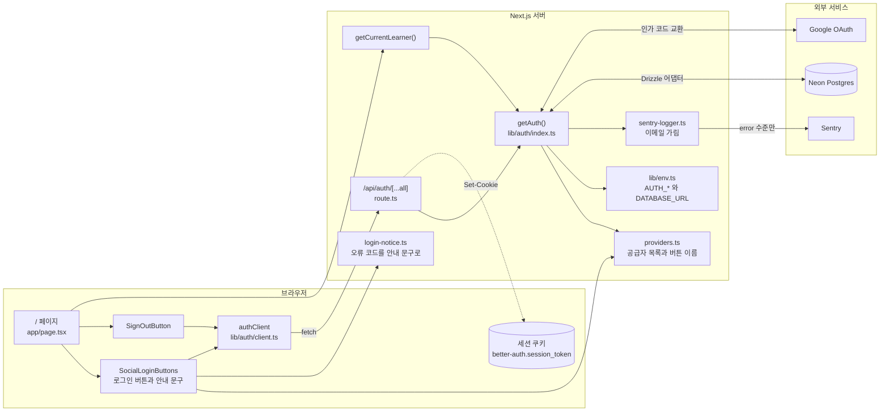
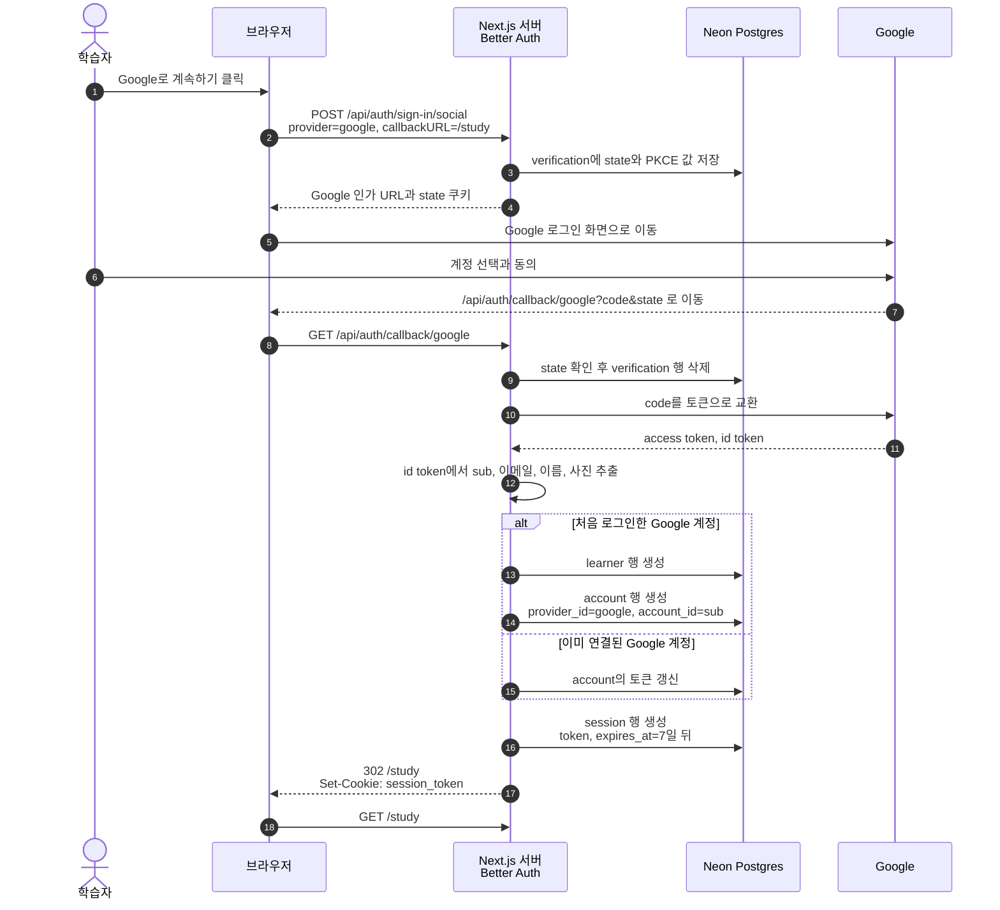
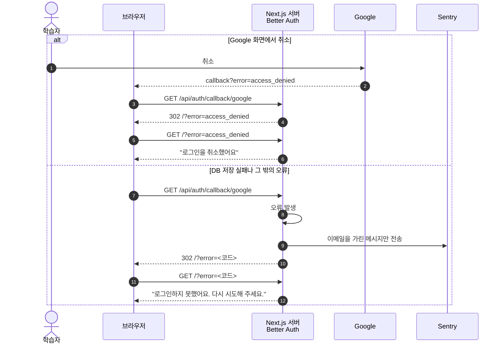
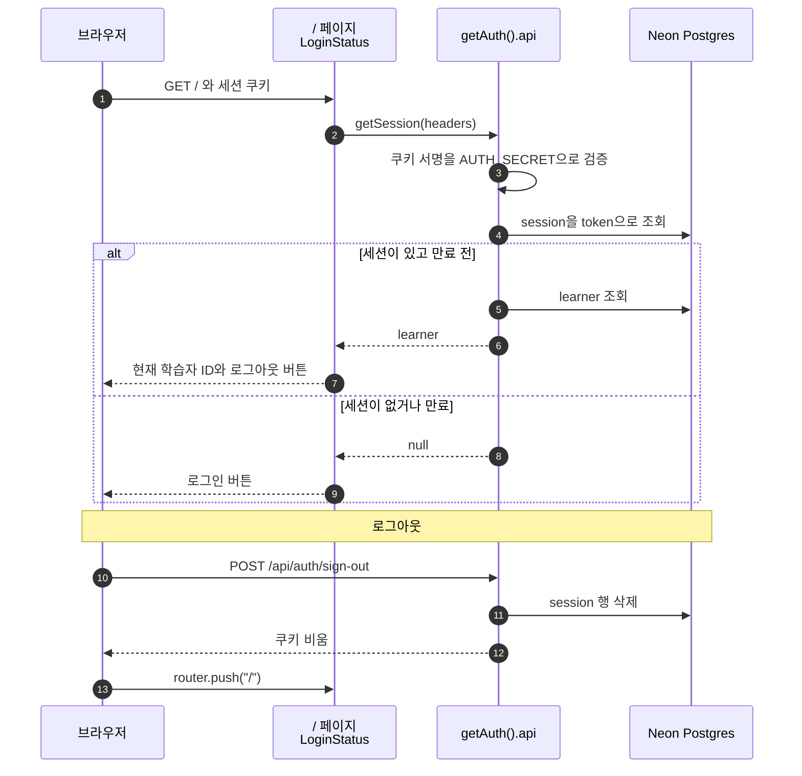
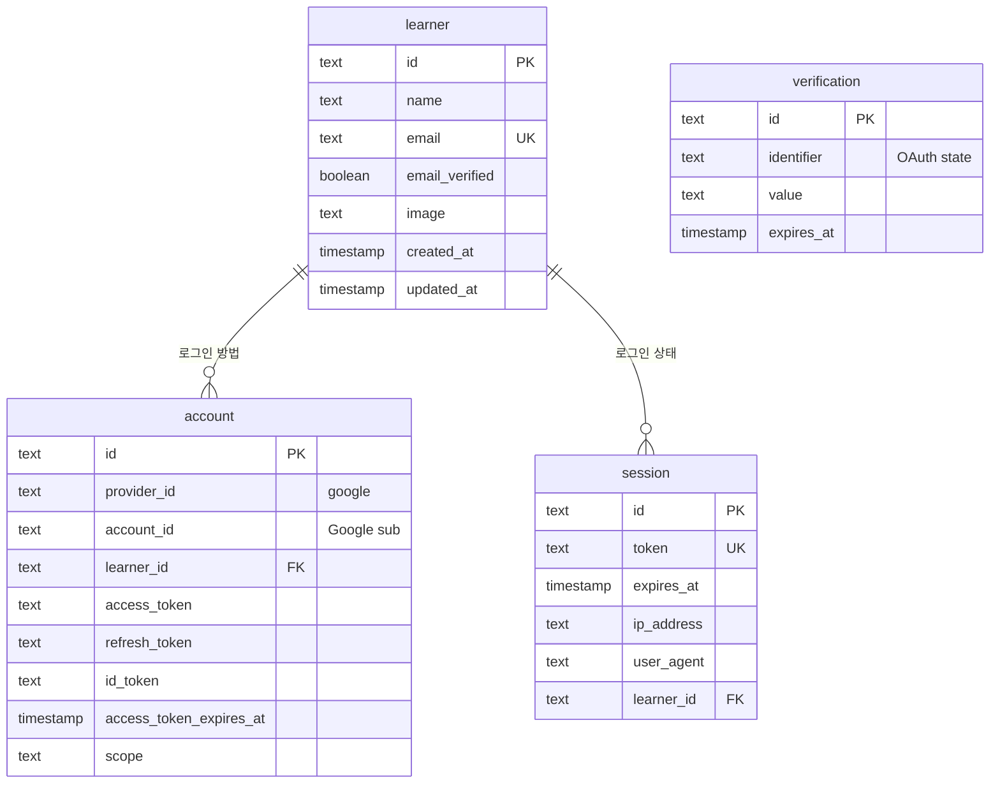
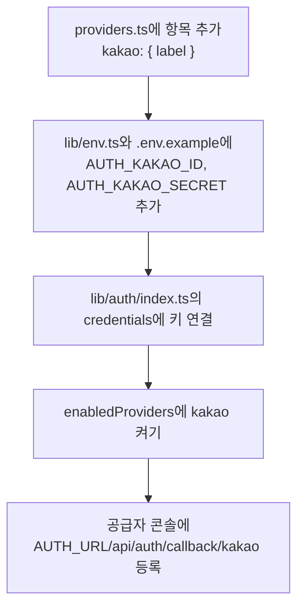

# 소셜 로그인 설계

Linear 4-48에서 구현한 Google 로그인의 구조와 흐름을 정리한다. 기준은 2026-11-02 기준 `4-48` 브랜치의 커밋하지 않은 코드다. 인증 도구를 Better Auth로 정한 이유는 [ADR 0004](../wiki/adr/0004-social-login.md)에, 테스트 기준은 [ADR 0006](../wiki/adr/0006-test-strategy.md)에 있다.

## 한눈에 보기

- 로그인 방법은 Google 하나다. 카카오와 네이버는 공급자 목록에 항목을 더하는 방식으로 늘린다.
- 로그인 처리는 Better Auth가 맡고, 결과는 Neon Postgres의 `learner`, `account`, `session`, `verification` 테이블에 남는다.
- 세션 본문은 DB에 있고, 브라우저 쿠키에는 세션 토큰과 서명만 들어간다.
- 로그인에 성공하면 `/study`로, 실패하거나 취소하면 `/`로 돌아온다.
- 인증 오류는 이메일을 가린 메시지 문자열만 Sentry로 보낸다.

## 전체 구조

### 파일별 역할

| 파일 | 역할 |
| --- | --- |
| `lib/auth/providers.ts` | 브라우저와 서버가 함께 쓰는 공급자 목록이다. 비밀값은 두지 않는다. |
| `lib/auth/index.ts` | Better Auth 설정을 만든다. 첫 호출에서 만들어 환경 변수 없는 빌드가 실패하지 않게 한다. |
| `lib/auth/client.ts` | 브라우저에서 로그인과 로그아웃을 호출하는 Better Auth 클라이언트다. |
| `lib/auth/login-notice.ts` | `?error=` 코드를 학습자에게 보여 줄 문구로 바꾼다. |
| `lib/auth/sentry-logger.ts` | Better Auth 로그에서 이메일을 가리고, 오류만 Sentry에 보낸다. |
| `app/api/auth/[...all]/route.ts` | `/api/auth/*` 요청을 모두 Better Auth로 넘긴다. |
| `app/_components/social-login-buttons.tsx` | 켜진 공급자마다 버튼을 그리고 안내 문구를 보여 준다. |
| `app/_components/sign-out-button.tsx` | 로그아웃한 뒤 `/`로 보낸다. |
| `app/page.tsx` | 4-51에서 첫 화면을 만들기 전까지 로그인 확인용 화면이다. |

## 로그인 성공 흐름

## 로그인 실패와 취소 흐름

`errorCallbackURL`과 `onAPIError.errorURL`을 모두 `/`로 두어, 어느 단계에서 실패해도 로그인 버튼이 있는 화면으로 돌아온다.

## 세션 확인과 로그아웃

세션 쿠키는 `HttpOnly`, `SameSite=Lax`이고, HTTPS에서는 `Secure`와 `__Secure-` 접두어가 붙는다. 만료는 7일이며, 하루가 지난 뒤 요청이 오면 다시 7일로 늘어난다. 쿠키 캐시는 켜지 않아서 세션을 확인할 때마다 DB를 조회한다.

## 데이터 구조

- `account`에는 `provider_id`와 `account_id` 묶음에 고유 인덱스가 있다. 같은 Google 계정이 두 학습자로 나뉘지 않는다.
- `learner`를 지우면 연결된 `account`와 `session`도 함께 지워진다.
- `verification`은 로그인 도중에만 쓰고, 콜백을 처리하면 지운다.
- Better Auth가 쓰는 이름은 `user`와 `userId`지만, 테이블은 `learner`, 열은 `learner_id`로 바꿨다.

## 공급자를 늘리는 방법

`credentials`의 타입이 `Record<ProviderId, ...>`라서, 목록에 항목을 넣고 키를 잇지 않으면 타입 검사가 실패한다.

## 남은 결정과 확인 필요

| 항목 | 현재 상태 | 영향 |
| --- | --- | --- |
| 계정 자동 연결 | 꺼 두었다 | 카카오로 로그인한 이메일이 기존 Google 학습자와 같으면 `account_not_linked`로 거절된다. 이슈의 기대와 다르므로 카카오 도입 전에 정해야 한다. `확인 필요` |
| 이메일 필수 | Better Auth가 `learner.email`을 요구한다 | 카카오가 이메일을 주지 않으면 대체 값이 필요하다. `확인 필요` |
| 저장하는 개인 정보 | 이름, 이메일, 사진, OAuth 토큰을 저장하고 토큰은 암호화하지 않는다 | 저장 범위를 줄일지 정해야 한다. `제안` |
| 운영 DB 마이그레이션 | test 브랜치에만 적용했다 | 운영 배포 전에 `drizzle/0000_login_tables.sql`을 적용해야 한다 |
| 운영 환경 변수 | 로컬에서만 설정했다 | 운영의 `AUTH_*` 값과 Google 리디렉션 URI 등록이 필요하다 |
| `/study` 화면 | 아직 없다 | 로그인 직후 404가 난다. 다른 이슈에서 만든다 |
