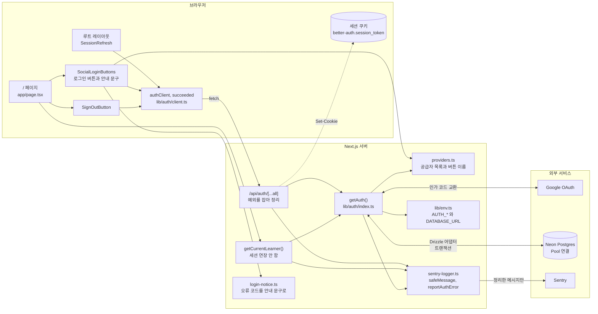
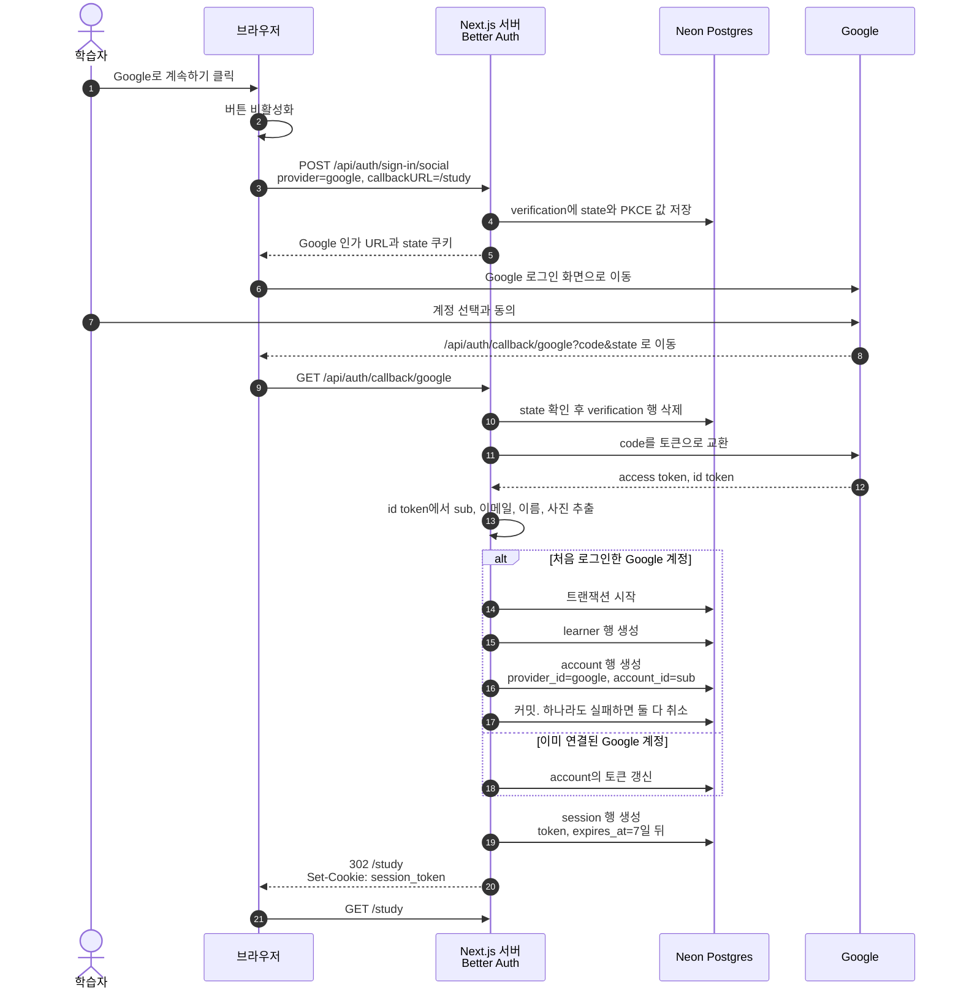
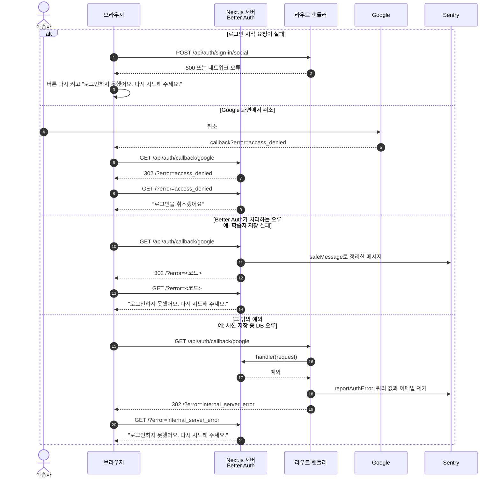
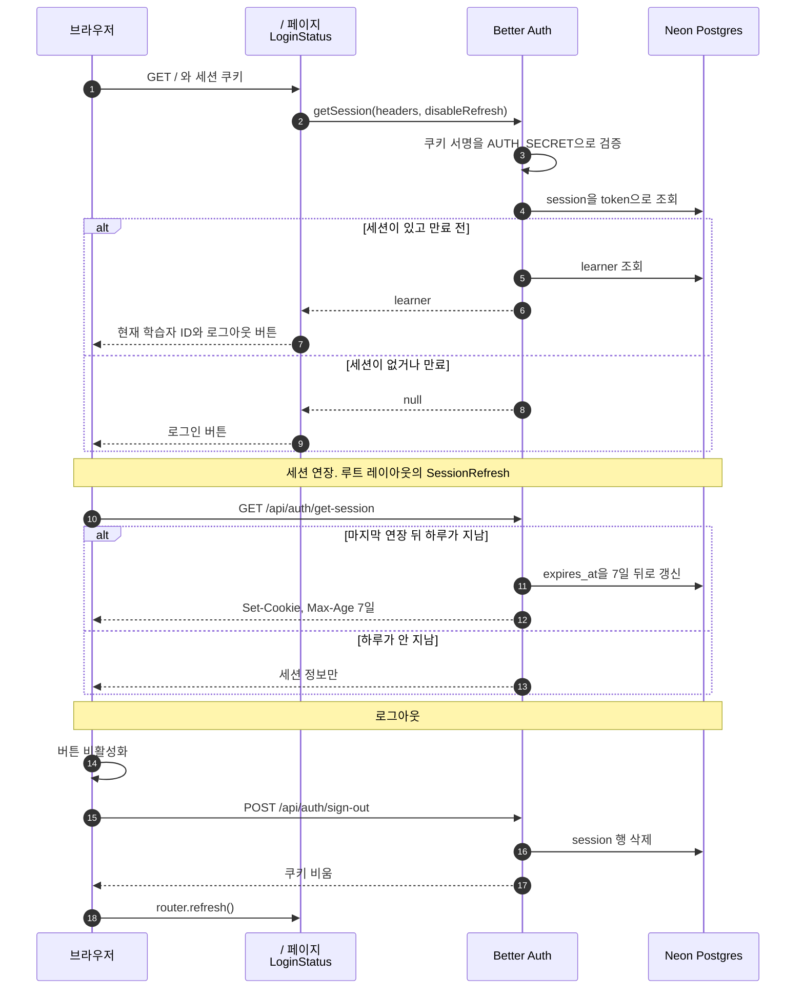
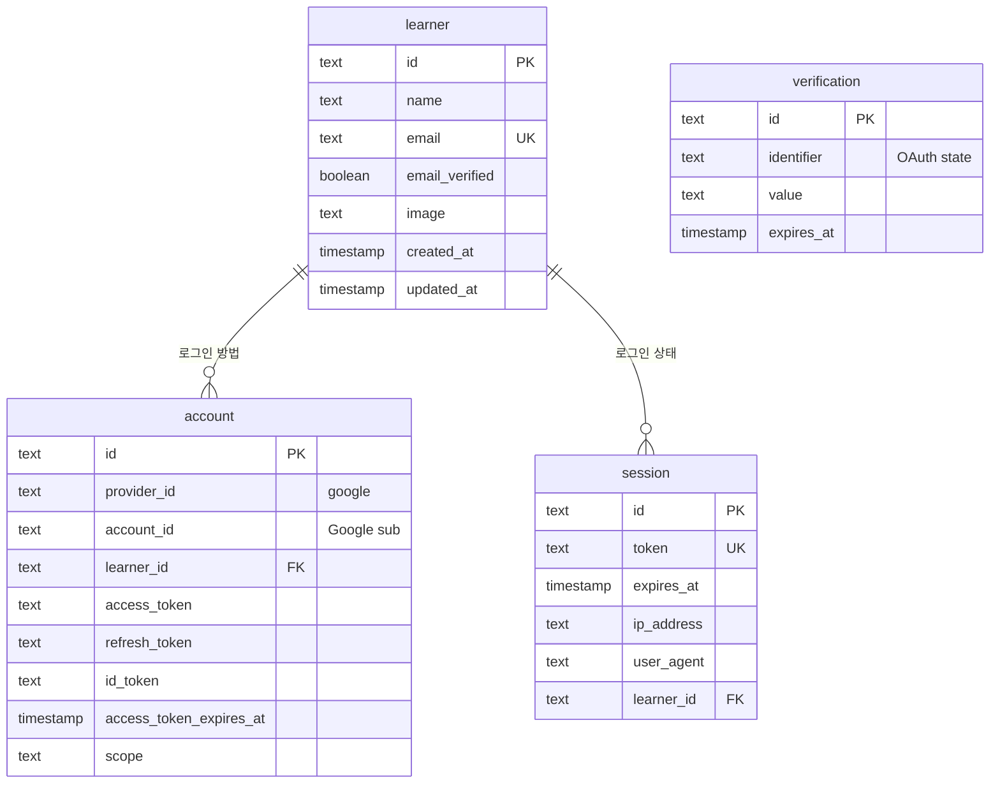
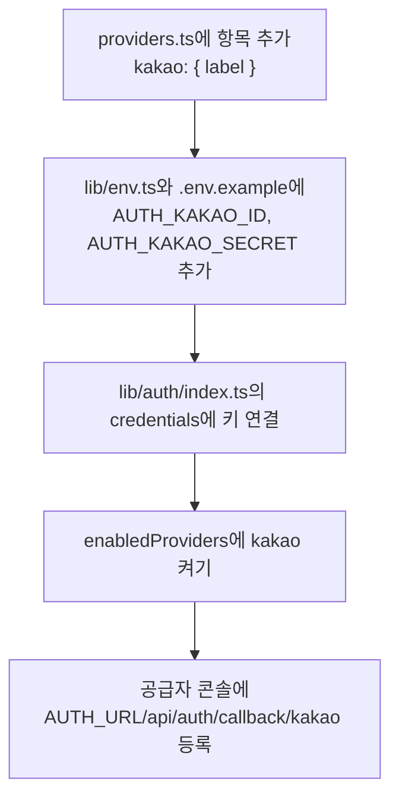

# 소셜 로그인 설계

Linear 4-48에서 구현한 Google 로그인의 구조와 흐름을 정리한다. 기준은 2026-11-02 `4-48` 브랜치 코드이며, 같은 날 커밋 전 코드 리뷰에서 바꾼 내용까지 반영했다. 인증 도구를 Better Auth로 정한 이유와 리뷰에서 정한 내용은 [ADR 0004](../wiki/adr/0004-social-login.md)에, 오류 처리 방식은 [ADR 0005](../wiki/adr/0005-sentry-error-monitoring.md)에, DB 드라이버 변경은 [ADR 0003](../wiki/adr/0003-neon-postgres-drizzle.md)에, 테스트 기준은 [ADR 0006](../wiki/adr/0006-test-strategy.md)에, 공급자 추가 절차는 [로그인 공급자 추가 절차](../wiki/social-login-providers.md)에 있다.

## 코드 리뷰로 바뀐 것

| 바뀐 것 | 리뷰 전 | 리뷰 후 |
| --- | --- | --- |
| 첫 로그인 저장 | 학습자와 계정을 따로 저장해, 계정 저장만 실패하면 다시 로그인할 수 없는 학습자가 남았다 | Pool 드라이버의 트랜잭션으로 함께 저장하고 함께 취소한다 |
| 인증 중 DB 오류 | 원본 오류가 토큰, IP와 함께 서버 로그와 Sentry에 남고, 로그인은 빈 500 화면으로 끝났다 | 정리한 메시지만 남기고, 로그인은 `/?error=internal_server_error`로 돌아온다 |
| 세션 연장 | DB 만료일만 늘고 쿠키는 로그인 7일 뒤 만료됐다 | 브라우저의 세션 확인이 하루에 한 번 쿠키와 DB를 함께 7일로 늘린다 |
| 로그인, 로그아웃 버튼 | 실패해도 아무 표시가 없고 두 번 누를 수 있었다 | 요청 중 비활성화하고, 실패하면 다시 시도 안내를 보여 준다 |
| 로그아웃 뒤 화면 | `router.push("/")` | `router.refresh()` |

## 한눈에 보기

- 로그인 방법은 Google 하나다. 카카오와 네이버는 공급자 목록에 항목을 더하는 방식으로 늘린다.
- 로그인 처리는 Better Auth가 맡고, 결과는 Neon Postgres의 `learner`, `account`, `session`, `verification` 테이블에 남는다. DB 연결은 트랜잭션을 지원하는 Pool 방식이다.
- 세션 본문은 DB에 있고, 브라우저 쿠키에는 세션 토큰과 서명만 들어간다. 7일 동안 쓰지 않으면 만료한다.
- 로그인에 성공하면 `/study`로, 실패하거나 취소하면 `/`로 돌아온다.
- 인증 오류는 쿼리 값을 지우고 이메일을 가린 메시지 문자열만 서버 로그와 Sentry에 남긴다.

## 전체 구조

### 파일별 역할

| 파일 | 역할 |
| --- | --- |
| `lib/db/index.ts` | `drizzle-orm/neon-serverless` Pool 연결을 첫 호출에서 만든다 |
| `lib/auth/providers.ts` | 브라우저와 서버가 함께 쓰는 공급자 목록이다. 비밀값은 두지 않는다 |
| `lib/auth/index.ts` | Better Auth 설정을 만든다. 트랜잭션을 켜고, API 오류가 아닌 예외는 라우트로 던지게 한다. `findLearner`는 세션을 연장하지 않고, 오류는 정리해서 다시 던진다 |
| `lib/auth/client.ts` | 브라우저의 Better Auth 클라이언트와, 요청 성공 여부를 판정하는 `succeeded`가 있다 |
| `lib/auth/login-notice.ts` | `?error=` 코드를 학습자에게 보여 줄 문구로 바꾼다 |
| `lib/auth/sentry-logger.ts` | `safeMessage`가 쿼리 값과 이메일을 지우고, `reportAuthError`가 그 메시지만 로그와 Sentry에 남긴다 |
| `app/api/auth/[...all]/route.ts` | `/api/auth/*` 요청을 Better Auth로 넘기고, 예외는 정리해서 GET은 `/?error=`로, POST는 500 JSON으로 돌려준다 |
| `app/_components/social-login-buttons.tsx` | 켜진 공급자마다 버튼을 그리고, 요청 중 비활성화와 실패 안내를 맡는다 |
| `app/_components/sign-out-button.tsx` | 로그아웃이 성공하면 화면을 다시 그리고, 실패하면 안내를 보여 준다 |
| `app/_components/session-refresh.tsx` | 페이지를 열 때 브라우저에서 세션을 한 번 확인해 쿠키 연장을 맡긴다 |
| `app/page.tsx` | 4-51에서 첫 화면을 만들기 전까지 로그인 확인용 화면이다 |

## 로그인 성공 흐름

## 로그인 실패와 취소 흐름

## 세션 확인, 연장, 로그아웃

- 서버 컴포넌트는 쿠키를 쓸 수 없다. 그래서 `/`의 세션 조회는 `disableRefresh`로 연장하지 않고, 연장은 쿠키를 쓸 수 있는 브라우저 요청에만 맡긴다. 서버가 먼저 DB 만료일을 늘리면 브라우저 요청이 연장할 필요가 없다고 보고 쿠키를 새로 쓰지 않는다.
- 세션 쿠키는 `HttpOnly`, `SameSite=Lax`이고, HTTPS에서는 `Secure`와 `__Secure-` 접두어가 붙는다.
- 쿠키 캐시는 켜지 않아서 세션을 확인할 때마다 DB를 조회한다.

## 데이터 구조

- `account`에는 `provider_id`와 `account_id` 묶음에 고유 인덱스가 있다. 같은 Google 계정이 두 학습자로 나뉘지 않는다.
- `learner`를 지우면 연결된 `account`와 `session`도 함께 지워진다.
- `verification`은 로그인 도중에만 쓰고, 콜백을 처리하면 지운다.
- Better Auth가 쓰는 이름은 `user`와 `userId`지만, 테이블은 `learner`, 열은 `learner_id`로 바꿨다.
- 운영 DB에는 2026-11-02에 마이그레이션을 적용했다. 적용 전 상태는 Neon 백업 브랜치 `backup-before-login-tables-2026-11-02`에 있다.

## 공급자를 늘리는 방법

자세한 절차는 [로그인 공급자 추가 절차](../wiki/social-login-providers.md)에 있다.

`credentials`의 타입이 `Record<ProviderId, ...>`라서, 목록에 항목을 넣고 키를 잇지 않으면 타입 검사가 실패한다.

## 남은 결정과 확인 필요

| 항목 | 현재 상태 | 영향 |
| --- | --- | --- |
| 계정 자동 연결 | 꺼 두었다 | 카카오로 로그인한 이메일이 기존 Google 학습자와 같으면 `account_not_linked`로 거절된다. Linear 4-48의 기대와 다르므로 카카오 도입 전에 정해야 한다. `확인 필요` |
| 이메일 필수 | Better Auth가 `learner.email`을 요구한다 | 카카오가 이메일을 주지 않으면 대체 값이 필요하다. `확인 필요` |
| 저장하는 개인 정보 | 이름, 이메일, 사진, OAuth 토큰을 저장하고 토큰은 암호화하지 않는다 | 저장 범위를 줄일지 정해야 한다. `제안` |
| 인증 밖의 DB 오류 | 정리 처리를 거치지 않는다 | 질문과 기록 저장 기능을 만들 때 같은 방식으로 막아야 한다. `제안` |
| 미리보기 배포 | 환경 변수를 Production에만 넣었다 | 미리보기 배포의 `/`는 오류가 날 수 있다. 로그인이 필요한지 정해야 한다 |
| 운영 로그인 확인 | 머지 뒤 확인한다 | Google OAuth 앱이 테스트 상태면 등록한 테스트 사용자만 로그인할 수 있다 |
| Pool 연결 지연 | 재지 않았다 | 첫 요청이 HTTP 방식보다 조금 느릴 수 있다 |
| `/study` 화면 | 아직 없다 | 로그인 직후 404가 난다. 4-50에서 만든다 |
