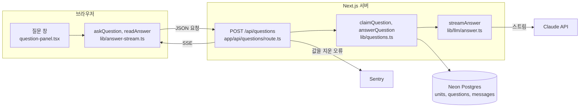
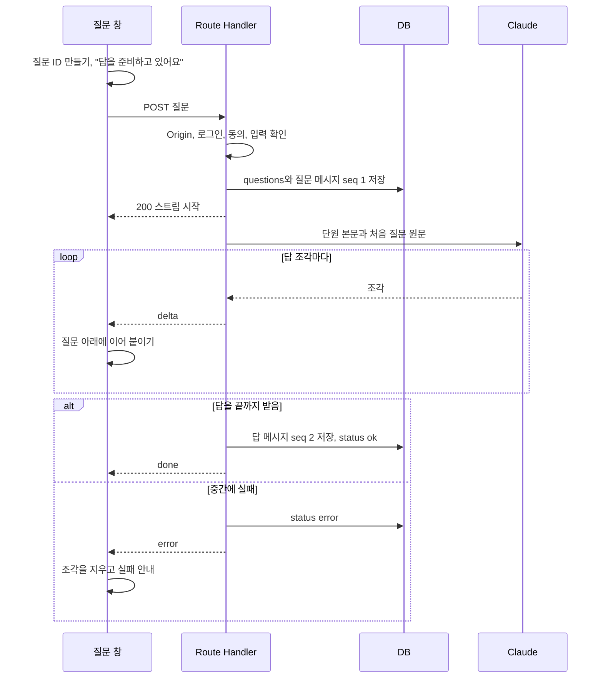
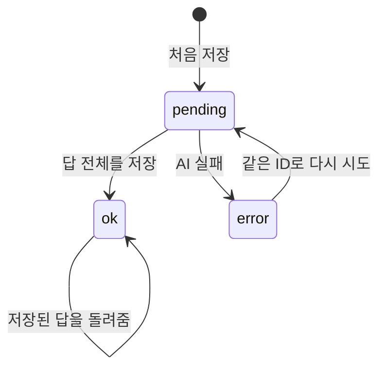
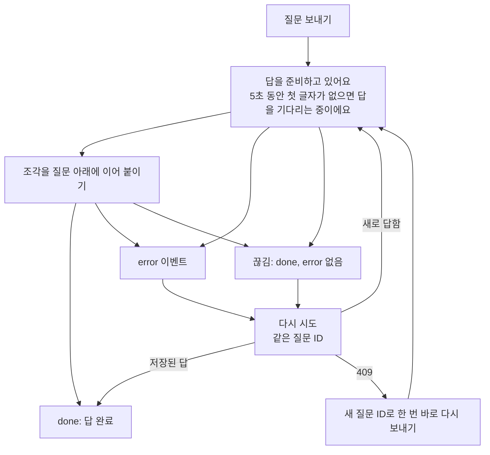

# 질문을 받아 AI 답을 스트리밍으로 돌려주는 서버와 질문 창

Linear [4-59](https://linear.app/silo0/issue/4-59)에서 만든 서버와, [4-60](https://linear.app/silo0/issue/4-60)에서 학습 화면의 질문 창을 서버에 이은 결과를 정리한 문서예요. 서버는 처음에 서버 액션으로 답을 한 번에 돌려줬는데, 지금은 답을 SSE 스트리밍으로 흘려보내요. 11/4에 정한 오류와 재시도 정책은 서버와 질문 창 모두에 반영했고, 기준은 2026-11-04 `4-60` 브랜치 코드예요. 저장 구조의 근거는 Linear 문서 [05-1 기록 구조 테이블 설계](https://linear.app/silo0/document/05-1-기록-구조-테이블-설계-0c3075a457c4)에, 테스트 기준은 [ADR 0006](../wiki/adr/0006-test-strategy.md)에 있어요.

## 한눈에 보기

- 질문 창은 `POST /api/questions`를 `fetch`로 부르고, 답 조각이 오는 대로 질문 아래에 이어 붙여요.
- 보내자마자 "답을 준비하고 있어요"를 보여 주고, 5초 동안 첫 글자가 없으면 "답을 기다리는 중이에요"로 바꿔요.
- 서버는 질문을 먼저 저장하고, 답을 끝까지 받으면 답 전체를 저장해요. 학습자가 중간에 창을 닫아도 끝까지 받아 저장해요.
- AI가 중간에 실패하면 서버는 받은 앞부분을 저장하지 않고 질문을 `error`로 남겨요. 화면은 받던 조각을 지우고 실패 안내와 "다시 시도"를 보여 줘요. 다시 시도는 같은 질문 ID로 보내요.
- AI가 60초 안에 답을 시작하지 않으면 실패로 끝내요. 답을 기다리는 동안에는 연결 유지 신호를 보내요.
- 학습자가 `pending`을 기다리지 않도록, 화면은 다시 시도했다가 409를 받으면 같은 내용을 새 질문 ID로 바로 다시 물어요.

## 화면과 맞춘 약속

보내는 본문은 JSON `{ questionId, unitId, content }`예요. 질문 ID는 화면이 `crypto.randomUUID()`로 만들어요. `unitId`는 보낼 때 열려 있던 단원이고, 다시 시도할 때도 처음 값을 그대로 보내요.

| 응답 | 뜻 | 화면이 하는 일 |
| --- | --- | --- |
| 200 스트림, `done`으로 끝남 | `delta` 이벤트가 이어지다가 끝나요 | 조각을 이어 붙여 보여 주고 답을 확정해요 |
| 200 스트림, `delta` 하나와 `done` | 이미 답한 질문이라 저장된 답을 한 번에 보내요 | 그대로 보여 줘요 |
| 200 스트림, `error`로 끝남 | AI가 답하지 못했어요 | 받던 조각을 지우고 "답을 가져오지 못했어요. 다시 보내 주세요."와 "다시 시도"를 보여 줘요 |
| 200 스트림, `done`이나 `error` 없이 끊김 | 연결이 끊겼어요 | 받던 조각을 지우고 "응답이 끊겼어요"와 "다시 시도"를 보여 줘요 |
| 409 | 같은 질문을 다른 요청이 아직 답하는 중이에요 | 같은 내용을 새 질문 ID로 한 번 바로 보내요. 새 ID도 409면 실패 안내를 보여 줘요 |
| 401 | 세션이 없어 로그인이 풀렸어요 | 첫 화면으로 보내요. 쿠키가 남아 있으면 학습 화면의 기존 흐름이 정리해요 |
| 403, 400, 404, 500 | 동의, 권한, 형식, 단원, 서버 오류예요 | 지금은 모두 "답을 가져오지 못했어요. 다시 보내 주세요."와 "다시 시도"를 보여 줘요. 남은 것 절을 보세요 |

스트림 한 덩어리는 이렇게 생겼어요.

```text
event: delta
data: {"text":"HAVING은 "}

event: done
data: {}
```

답을 기다리는 동안에는 15초마다 `: ping` 주석 줄이 와요. 화면은 이벤트 이름이 없는 줄이라 건너뛰어요.

## 구조



| 파일 | 하는 일 |
| --- | --- |
| `app/study/(unit)/_components/question-panel.tsx` | 질문 한 건을 보내는 중, 답함, 실패 중 하나의 상태로 들고, 상태에 맞는 답과 안내를 보여 줘요. 레이아웃에 있어서 단원을 옮겨도 대화가 남아요 |
| `lib/answer-stream.ts` | 질문을 보내고 SSE를 읽어요. 조각이 올 때마다 지금까지 이은 답을 넘기고, 결과를 성공이나 실패 이유 `failed`, `cut`, `pending`으로 돌려줘요 |
| `app/api/questions/route.ts` | Origin, 로그인, 동의, 입력을 확인하고 결과를 상태 코드나 SSE로 바꿔요 |
| `lib/questions.ts` | 질문을 저장하고 이 요청이 할 일을 정하고, 답을 받아 저장해요 |
| `lib/llm/answer.ts` | 단원 본문과 질문을 Claude에게 보내고 답 조각을 넘겨요. effort는 `low`예요 |
| `lib/study-day.ts` | 질문한 시각을 한국 시간 새벽 4시 기준 학습일로 바꿔요 |

## 질문 하나가 처리되는 흐름



학습자가 중간에 연결을 끊으면 서버는 보내기만 멈추고 나머지 흐름은 그대로 이어가요. Next.js의 `after`로 응답이 끝난 뒤에도 Vercel이 함수를 기다리게 했어요. 화면은 `done`이나 `error`를 받으면 읽기를 멈추고 연결을 닫아요.

## 같은 질문 ID가 다시 올 때



`error`에서 `pending`으로 바꾸는 요청은 하나만 성공해요. 동시에 온 나머지는 409를 받아요.

## 시간 제한

Vercel 문서에서 Hobby의 함수 최대 시간이 300초인 것을 확인했어요. Fluid compute가 기본으로 켜진 경우예요. 그래서 이렇게 맞췄어요.

| 값 | 이유 |
| --- | --- |
| `maxDuration` 300초 | Hobby가 허용하는 최대값이에요 |
| Claude 요청 마감 240초 | 재시도까지 합쳐 이 안에 끝나지 않으면 끊고 `error`로 남겨요. 300초에 함수가 끊겨 `pending`에 남는 일을 막아요 |
| 첫 글자 60초 | 이 안에 답의 첫 글자가 오지 않으면 끊고 `error`로 남겨요. 학습자가 답이 시작되기를 마냥 기다리지 않게 해요. 운영하며 조정할 값이에요 |
| 연결 유지 15초 | AI가 생각하는 동안 연결이 조용하면 중간 장비가 끊을 수 있어 주석 줄을 보내요 |
| 화면 문구 5초 | 첫 글자가 5초 동안 오지 않으면 "답을 기다리는 중이에요"로 바꿔요. 개발자가 4-60에서 10초를 5초로 바꿨고, 근거는 [ADR 0007](../wiki/adr/0007-ai-model.md)에 있어요 |

서버의 두 제한 중 어느 쪽에 걸렸는지는 Sentry 오류 메시지로 구분해요. 60초 값을 조정할 때 근거로 써요.

## 오류와 재시도 정책

11/4에 정한 정책이에요. 다른 AI 서비스와 공식 문서를 조사한 근거와 출처는 [AI 응답 오류와 재시도 처리 조사](../raw/2026-11-04-ai-error-retry-research.md)에 있어요. 핵심은 학습자가 `pending`을 기다리지 않게 하는 거예요. 원천 자료에는 문구를 바꾸는 시점이 10초로 적혀 있고, 4-60에서 5초로 바꿨어요.

| 상황 | 처리 | 맡는 곳 |
| --- | --- | --- |
| Claude 연결 오류, 429, 5xx | SDK가 첫 글자 전에 2번까지 다시 시도해요 | 서버 |
| 답 도중 실패, 첫 글자 60초 초과, 전체 240초 초과 | 다시 시도하지 않고 `error` 이벤트로 끝내요 | 서버 |
| `error` 이벤트를 받음 | 받던 조각을 지우고 일반 문구와 "다시 시도"를 보여 주고, 누르면 같은 질문 ID로 보내요 | 질문 창 |
| `done`이나 `error` 없이 스트림이 끊김 | 받던 조각을 지우고 "응답이 끊겼어요"와 "다시 시도"를 보여 줘요. 이미 저장된 답이 있으면 바로 받아요 | 질문 창 |
| 다시 보냈는데 409 | 같은 질문 내용을 새 질문 ID로 한 번 바로 보내요 | 질문 창 |
| 남은 `pending` | 05-1 규칙대로 5분이 지나면 기록 화면과 지표에서 `error`로 봐요. DB는 고치지 않아요 | 기록 화면 |



409 뒤에 새 ID로 보낼 때 예전 요청이 살아 있으면 같은 질문에 답이 두 번 만들어지고, DB에 같은 질문이 두 줄 남을 수 있어요. 대화 화면에는 질문 하나와 새 ID의 답만 보여요. 예전 요청을 멈춰도 AI 비용은 아낄 수 없어서, 개발자가 4-60에서 이 중복을 받아들이기로 했어요.

## 코드 리뷰로 바꾼 것

4-59 서버를 만들 때 바꾼 것이에요.

| 문제 | 바꾼 것 |
| --- | --- |
| `next dev`는 Host 헤더가 아니라 띄운 호스트 이름으로 요청 주소를 만들어, `127.0.0.1`로 열면 모든 질문이 403이 됐어요 | Origin을 로그인과 같은 서비스 주소 `AUTH_URL`과 비교해요 |
| 60초 제한과 240초 제한이 Sentry에서 같은 중단 오류로 보였어요 | 어느 제한에 걸렸는지 담은 오류를 남겨요 |
| 시간 제한 테스트가 중간에 실패하면 가짜 타이머를 기다리던 작업 때문에 DB 정리가 멈출 수 있었어요 | 정리 전에 남은 가짜 타이머를 먼저 실행해요 |

서버 액션으로 만들 때 더한 안전장치는 그대로예요. DB 오류의 쿼리 값을 지우고, 4000자까지만 받고, 길이 제한에서 끊긴 답은 실패로 보고, `pending`인 질문만 `error`로 바꿔요.

4-60 질문 창을 만들 때 바꾼 것이에요. 두 번째 리뷰에서는 더 나온 것이 없었어요.

| 문제 | 바꾼 것 |
| --- | --- |
| 서버는 조각을 흘려보내는데 화면은 `done`까지 기다렸다가 한 번에 보여 줬어요 | 조각이 올 때마다 질문 아래에 이어 붙여요 |
| 화면 낭독기로는 실패를 알 수 없었어요 | 실패 안내를 `role="alert"`로 알려요 |
| 새 질문 ID도 409를 받으면 질문을 끝없이 다시 보낼 수 있었어요 | 새 ID로 다시 보내는 것은 한 번만 하고, 그다음 409는 실패로 끝내요 |
| 답을 일찍 그만 읽어도 연결이 열려 있었어요 | 읽기를 마치면 연결을 닫아요 |
| 다시 시도 버튼이 사라지면서 키보드 포커스를 잃었어요 | 다시 시도를 누르면 포커스를 질문 입력으로 옮겨요 |
| 5초 문구 테스트가 실제 시간이 흐르면 느린 환경에서 실패할 수 있었어요 | 페이지를 연 뒤 가짜 시계를 멈추고 시간을 직접 넘겨요 |

## 테스트

노션 Test-case DB에서 4-59와 4-60에 연결된 확정 케이스를 모두 테스트로 옮겼고 모두 통과했어요. 통합 테스트는 실제 테스트 DB를 쓰고 Claude만 목으로 바꿔요. E2E는 `e2e/fixtures.ts`가 질문 요청을 기본으로 가로채 응답하지 않게 해서, 실제 AI를 부르지 않고 테스트 학습자에 질문 줄을 남기지 않아요. 답을 다루는 테스트만 응답을 정해요.

서버 케이스예요. 4-59에서 만들었어요.

| 케이스 | 확인하는 것 |
| --- | --- |
| TC-34 | 답 조각이 `delta`로 오고 `done`으로 끝나며, 질문과 답이 저장돼요 |
| TC-35 | 이미 답한 질문은 저장된 답을 `delta` 하나와 `done`으로 돌려줘요 |
| TC-36 | 답하는 중인 질문은 409예요 |
| TC-37 | 다른 학습자의 질문 ID는 403이에요 |
| TC-38 | 세션이 없으면 401, 동의하지 않았으면 403이고 화면을 옮기지 않아요 |
| TC-39 | AI가 실패하면 `error` 이벤트로 끝나고 질문이 `error`로 남아요 |
| TC-40 | 실패한 질문을 다시 보내면 처음 질문으로 답을 받아요 |
| TC-41 | 학습일은 한국 시간 새벽 4시 기준이에요. `lib/study-day.test.ts`에 있어요 |
| TC-42 | 열려 있던 단원 본문을 AI에게 넘겨요 |
| TC-43 | 빈 질문은 400이에요 |
| TC-45 | 답 도중 AI가 실패하면 앞부분 뒤에 `error`로 끝나고 앞부분은 저장하지 않아요 |
| TC-46 | 첫 조각 뒤에 연결을 끊어도 답 전체가 저장돼요 |
| TC-47 | 다른 사이트에서 보낸 요청은 403이에요 |
| TC-48 | AI가 60초 안에 답을 시작하지 않으면 `error`로 끝나요 |
| TC-49 | 답을 기다리는 동안 첫 `delta`보다 먼저 연결 유지 신호가 와요 |
| TC-50 | 실패한 질문을 동시에 다시 보내면 한 요청만 답을 받고 나머지는 409예요 |

질문 창 케이스예요. 4-60에서 만들었어요.

| 케이스 | 유형 | 확인하는 것 |
| --- | --- | --- |
| TC-51 | E2E | 실패한 질문을 다른 단원으로 옮긴 뒤 다시 시도해도 같은 질문 ID와 처음 단원으로 보내고, 질문은 하나만 남아요 |
| TC-52 | E2E | 첫 조각 전에는 "답을 준비하고 있어요"가 보이고, 답이 오면 표시가 사라져요. 두 질문의 ID가 달라요 |
| TC-53 | 단위 | 잘린 덩어리와 연결 유지 신호가 섞여도 조각을 이어 답을 만들어요 |
| TC-54 | 단위 | `error`와 500은 답을 가져오지 못한 실패, 끊긴 응답은 끊긴 실패, 409는 처리 중인 실패로 나눠요 |
| TC-55 | E2E | `done` 전에 첫 조각이 질문 아래에 보이고, 중간에 실패하면 받던 조각이 사라져요 |
| TC-56 | E2E | 첫 글자가 5초 동안 오지 않으면 "답을 기다리는 중이에요"로 바뀌어요 |
| TC-57 | E2E | 끊긴 질문을 다시 시도했는데 409면 같은 내용을 새 질문 ID로 바로 보내고, 질문은 하나만 남아요 |
| TC-58 | E2E | 질문을 보냈는데 401이면 실패 안내 없이 첫 화면으로 가요 |

서버 통합 테스트는 `app/api/questions/route.integration.test.ts`에, 응답 읽기 단위 테스트는 `lib/answer-stream.test.ts`에, 질문 창 E2E는 `e2e/question.spec.ts`에 있어요. TC-55는 Playwright의 `route.fulfill`이 본문을 한 번에 보내서, 브라우저의 `fetch`를 바꿔 조각 사이에 멈춘 응답을 흉내 내요. 4-60 작업 뒤 전체 결과는 단위 11건, 통합 30건, E2E 15건이 통과했고 `npm run check`도 통과했어요.

## 남은 것

| 항목 | 지금 상태 | 제안 |
| --- | --- | --- |
| 403, 400, 404 화면 처리 | 이전 약속은 다시 보내지 않는 것이었어요. 지금 질문 창은 일반 실패 안내와 "다시 시도"를 보여 주고, 다시 시도해도 같은 응답을 받아요. 이 중 실제로 생길 수 있는 것은 4000자를 넘는 질문의 400이고, 질문 입력에는 길이 제한이 없어요 | 오류 UI를 정할 때 입력 길이 제한이나 안내와 함께 정해요. 다시 시도 버튼만 숨기는 TC-59는 진행하지 않았어요 |
| 두 번째 409 테스트 | 새 ID도 409를 받으면 실패로 끝내는 안전장치는 코드에 있지만 테스트는 없어요. 지금 서버는 처음 보는 질문 ID에 409를 돌려주지 않아요 | TC-60은 진행하지 않았어요. 서버가 바뀌어 이 상황이 생길 수 있게 되면 다시 봐요 |
| 학습자별 분당 요청 제한 | 질문 ID를 바꿔 보내면 한 학습자가 시작하는 Claude 호출 수를 막지 못해요 | 제한 기준과 동시 요청에서도 우회되지 않는 처리 방식을 후속 이슈에서 정해요 |
